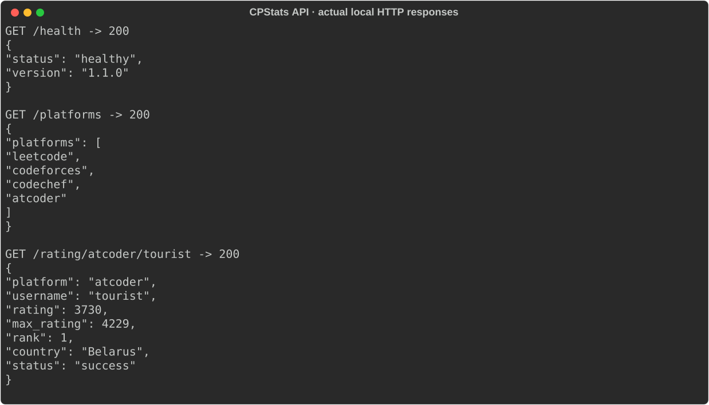
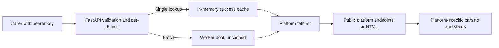

<div align="center">

# CPStats API

**One HTTP interface for public competitive-programming ratings.**

Look up a handle, keep its platform context, and return a clear status when the upstream site is unavailable.

[](main.py) [](Dockerfile) [](LICENSE)

[**Try locally**](#run-a-local-instance) · [**API behavior**](#responses-you-can-handle) · [**Verify**](#verify-and-contribute)

</div>

## A small bridge from profiles to a community bot

CPStats was built for the SST Lounge Discord community, which is now inactive. It gathers public profile ratings from AtCoder, Codeforces, CodeChef and LeetCode behind a consistent HTTP interface. The optional `/cp_rating` command in [SST Lounge Bot](https://github.com/Muneer320/SST-Lounge-Bot) can use it when both services are configured.



*Actual local HTTP responses captured on 2026-10-31, including a live public AtCoder lookup. Ratings change; this snapshot is an API example, not a current leaderboard or performance benchmark. The AtCoder and Codeforces live contract checks also passed during this review.*

| One handle or a batch | Preserve the meaning | Fail explicitly |
| --- | --- | --- |
| GET/POST single lookups and batches of up to 20 | Platform-specific results; unrated can be `null`, never an invented average | Distinct missing-user, invalid-input, upstream, authentication and rate-limit statuses |

> [!NOTE]
> **Maintained local service for a historical community project.** No working public deployment is claimed. Upstream markup, access restrictions or outages can break a lookup; a successful check today is not a guarantee for every provider or future request.

## Run a local instance

With Git and Docker installed:

```sh
git clone https://github.com/Muneer320/CPStats-API.git
cd CPStats-API
docker build -t cpstats-api .
docker run --rm -p 127.0.0.1:7860:7860 -e API_KEY=local-demo-key cpstats-api
```

The example key is for this loopback-only demo. Use a long private random key for an actual deployment; do not put it in a public frontend. Check health and make a best-effort live request from another terminal (PowerShell users can use `curl.exe`):

```sh
curl http://localhost:7860/health
curl -H "Authorization: Bearer local-demo-key" http://localhost:7860/rating/atcoder/tourist
```

Health returns HTTP 200 when a key is configured; a lookup returns rating data or a documented error. For the SST bot, set `CPSTATS_API_URL` to this API's base URL and `CPSTATS_API_KEY` to the same private key.

<details>
<summary><strong>Native Python setup and configuration</strong></summary>

Use Python 3.13 in a virtual environment. Install `python -m pip install -r requirements.txt`, copy `.env.example` to `.env` and set `API_KEY`. Start a loopback-only native server with:

```sh
python -m uvicorn main:app --host 127.0.0.1 --port 7860
```

`python main.py` also works but defaults to host `0.0.0.0` unless `API_HOST` is configured. `PORT` defaults to 7860. Review the environment example for cache, origin and rate-limit settings. The former Hugging Face Space, if restored, needs an `API_KEY` secret and the repository Dockerfile.

</details>

## Responses you can handle

| Endpoint | Access | Result |
|---|---|---|
| `GET /`, `GET /platforms` | Public | Service and platform information |
| `GET /health` | Public | 200 with a configured key; 503 without one |
| `GET /rating/{platform}/{username}` | Bearer key | One platform result |
| `POST /rating` | Bearer key | One result from `{"platform":"atcoder","username":"tourist"}` |
| `POST /ratings` | Bearer key | Up to 20 results; each item carries its own status |

Single lookups return 404 for a missing user, 502 for an upstream failure, 400 for an invalid platform, 401 for a missing/wrong key and 429 when the request limit is reached. Batch responses contain item statuses (`success`, `user_not_found`, `upstream_error` and validation errors); `successful_requests` counts only successes. Unrated users can have `rating: null`. Ratings across different platforms are not averaged.

Only successful single lookups enter the in-memory cache (default 15 minutes). `RATE_LIMIT_REQUESTS` and `RATE_LIMIT_WINDOW` set an in-memory limit per client IP and process. This is suitable for a small single-instance demo, not a distributed rate limit. `ALLOWED_ORIGINS` is empty by default; add explicit origins only for browser clients. Server-to-server callers do not need CORS.

## The lookup path



The cache and request limits belong to one process; this is not a distributed rate limiter or shared cache. Public handles and request metadata pass to the relevant upstream platform. There is no persistent profile-history database. CORS origins default to empty; server-to-server bot callers do not need browser CORS.

## Verify and contribute

```sh
python -m pip install pytest httpx
python -m pytest -q
```

The unit/API tests use fixed fixtures without third-party network access. The separate `python -m tests.live_contract` command and weekly GitHub workflow check live AtCoder/Codeforces responses and may flag upstream changes. Run the fixture tests for a parser/API change, include a sanitized upstream fixture when appropriate and document response/status changes. Report reproducible issues in [the tracker](https://github.com/Muneer320/CPStats-API/issues).

Source: [HTTP API](main.py), [platform fetchers](rating_fetcher.py), [tests](tests/). [MIT license](LICENSE).
